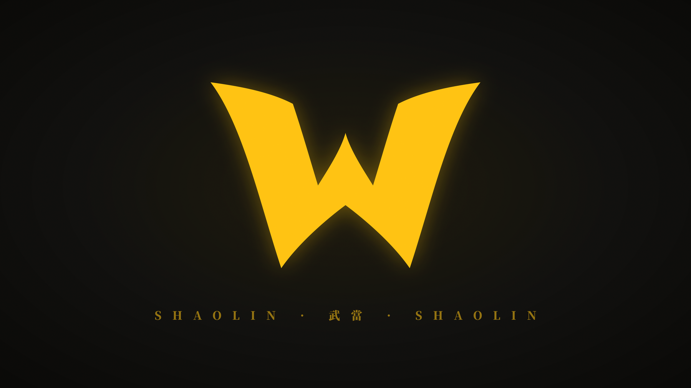

# Wu-Tang — Omarchy theme

Black and Wu yellow, Shaolin style. Temple vermilion, jade and bamboo
fill out the terminal palette. Window borders fade from yellow to red.



## Install

From the Omarchy menu: **Install → Theme**, then paste this repo's URL.

Or from a terminal:

```bash
omarchy theme install https://github.com/JPTGraczykowski/omarchy-wu-tang-theme
```

The theme then shows up as `wu-tang` in the theme picker.

## What's included

- `colors.toml`: the palette (Omarchy builds the terminal, bar, btop, Neovim and border colors from it)
- `icons.theme`: the `Yaru-yellow` icon set
- `unlock.png`: the winged W emblem on the boot/unlock screen
- `backgrounds/` (all 3840 × 2160):
  - `1-wu-emblem.jpg`: the winged W on black (default)
  - `2-shaolin-dusk.jpg`: pagoda, mountains and a yellow sun
  - `3-wu-tang.jpg`: 武當 in brush-style type
  - `4-36-chambers.jpg`: the 36 chambers, 少林三十六房
  - `5-killa-bee.jpg`: black W on yellow

## License

[MIT](LICENSE). Fan-made tribute; not affiliated with or endorsed by Wu-Tang Clan.
